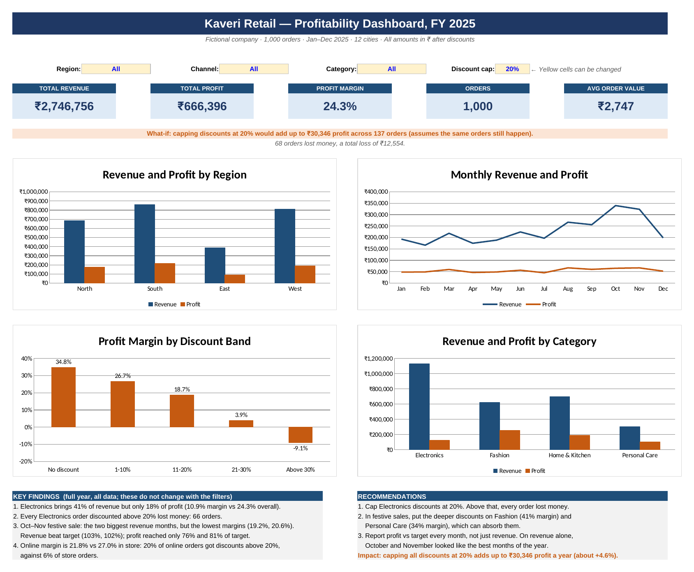
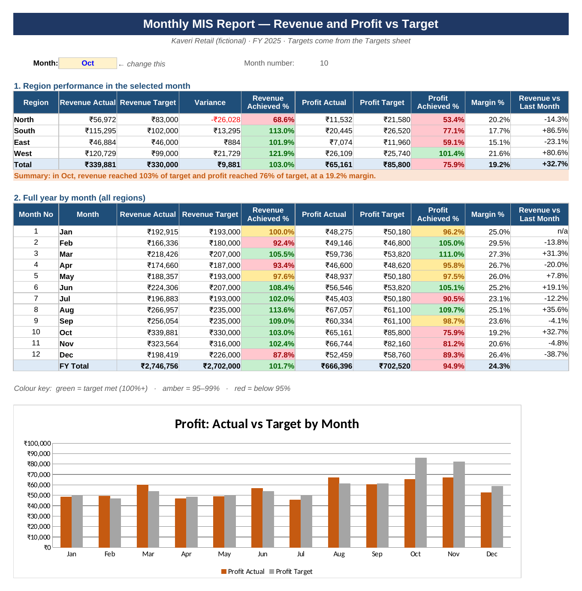

# Retail Profitability Analysis (Excel)

**Kaveri Retail** (a fictional company) sells electronics, fashion, home and personal-care products
in 12 Indian cities, online and in stores. In FY 2025 it hit its revenue target, but profit came in
below plan. I used Excel to find out why.

**File:** [Retail_Profitability_Analysis.xlsx](Retail_Profitability_Analysis.xlsx)
**Tools:** Excel (SUMIFS, COUNTIFS, VLOOKUP, INDEX/MATCH, named ranges, Excel Tables,
data validation, conditional formatting, charts)
**Data:** 1,000 orders, Jan–Dec 2025. The data is synthetic, created for this project.

---

## The business question

**Where is the business earning revenue without earning profit, and what should it change?**

## The answer

| | Revenue | Profit | Margin |
|---|---|---|---|
| FY 2025 | ₹27.47 lakh (102% of target) | ₹6.66 lakh (95% of target) | 24.3% |

**Deep discounts on Electronics are where the profit goes.**

1. **Electronics brings 41% of revenue but only 18% of profit**, at a 10.9% margin.
2. **Every Electronics order discounted above 20% lost money.** There were 66 of them.
3. **The Oct–Nov festive sale fooled the revenue report.** They were the two biggest revenue months
   and beat their revenue targets (103% and 102%), but profit reached only 76% and 81% of target.
   Margin fell to 19.2% in October, the lowest of the year.
4. **Online earns less than store** (21.8% vs 27.0% margin), because 20% of online orders got
   discounts above 20%, against 6% of store orders.

## Recommendations

1. **Cap Electronics discounts at 20%.** Above that, every order lost money.
2. **In festive sales, put the deeper discounts on Fashion (41% margin) and Personal Care (34%)**,
   which can absorb them.
3. **Track profit vs target in the monthly MIS report, not just revenue.**

**Impact:** capping all discounts at 20% would add up to **₹30,346 profit a year (about +4.6%)**.
This assumes the same orders still happen, so it is an upper limit.

## Monthly MIS report

Pick any month to see revenue and profit against target by region. October shows the problem:
revenue beat its target, but profit missed by 24%.

---

## What's in the workbook

| Sheet | What it does |
|---|---|
| **Dashboard** | KPI cards, 4 charts, findings and recommendations. Dropdown filters for Region, Channel and Category, plus a what-if discount cap |
| **MIS Report** | Pick a month: revenue and profit vs target by region, achievement %, variance, month-on-month growth. Full-year table with red/amber/green colours |
| **Analysis** | The summary tables behind the dashboard, all built with SUMIFS and COUNTIFS |
| **Cleaned Data** | 1,000 clean orders in an Excel Table. Revenue, cost, profit, margin and discount band are formulas |
| **Raw Data** | The data as received: 1,012 rows with duplicates and messy values |
| **Product List** | Price and cost for each of the 16 products (used by VLOOKUP) |
| **Targets** | Monthly revenue targets by region; profit target = revenue target × planned margin |
| **Cleaning Log** | Every cleaning step, how many rows it affected and the Excel feature used |

## How I cleaned the data

1,012 rows received → 1,000 clean orders.

| Problem | Rows | Fix |
|---|---|---|
| Duplicate orders | 12 | Remove Duplicates |
| Channel spelled in different ways ("online", "ONLINE", "In-store") | 64 | TRIM, PROPER, Find & Replace |
| City spelling ("Bangalore", lower case, extra spaces) | 60 | TRIM, PROPER, Find & Replace |
| Missing city | 6 | Marked "Unknown"; rows kept |
| Missing category | 9 | Filled from Product List with VLOOKUP |
| Discount stored as text ("15%") | 25 | VALUE |
| Date stored as text | 18 | Text to Columns (DMY) |

## How to use it

1. Download the workbook and open it in Excel. Click **Enable Editing** if Excel asks.
2. On the **Dashboard**, change the yellow cells. For example, pick *South* as Region. Every card
   and chart updates.
3. On the **MIS Report**, pick a month in the yellow cell to see that month's report.

## Credit

The idea for this project came from another analyst's public Excel project. See
[ATTRIBUTION.md](ATTRIBUTION.md).

---

**Pratham Hirolikar** · [GitHub](https://github.com/prathamhirolikar7-hash) · prathamhirolikar7@gmail.com
